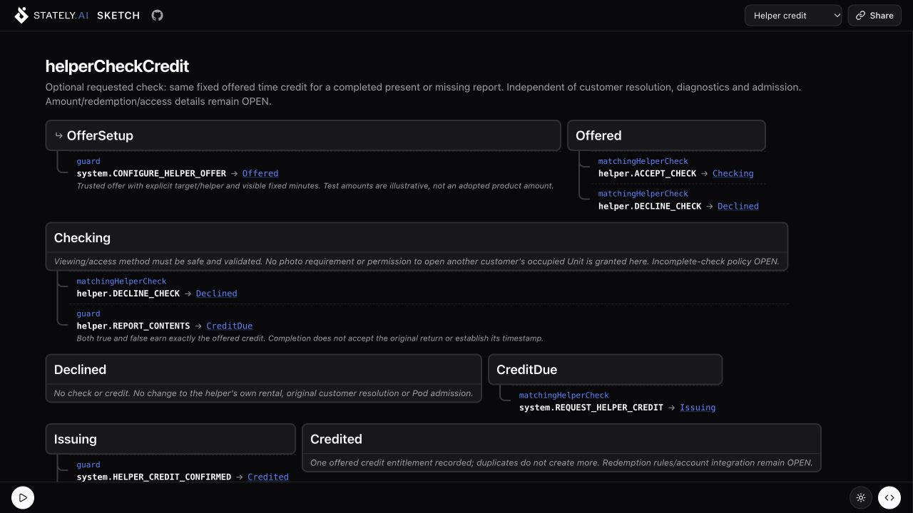

# Stately Sketch

Stately Sketch is a simple, responsive state machine visualizer and simulator for XState.


## What It Does

- Visualizes nested XState machines as responsive diagrams
- Simulates transitions, guards, and delayed events
- Lets you edit machine code and see updates immediately
- Supports XState code, Sketch DSL, JSON, YAML, and Mermaid input

## Locker deployment on Cloudflare

Live page: **[locker-stately.derektchang.workers.dev](https://locker-stately.derektchang.workers.dev/)**.
This fork loads the Locker rental design prototype from
[`src/lib/locker-rental.machine.mjs`](src/lib/locker-rental.machine.mjs) by default.
The header omits the Examples launcher, Help menu and signed-out Sign in button.
The **Flow** selector exposes Rental journey, Pod availability, Phone unavailable,
Powerless return and Helper credit. Switching flows preserves the editor source
and resets the previous simulation; each graph simulates independently.

The model covers fresh inspection/replacement time, authorization before unlock
and capture after accepted final return, failed-door recovery, auxiliary-return
admission suspension, device/outage recovery and optional fixed helper credit.
Helper credit amount/redemption and the physical powerless-return mechanism
remain open design decisions. The canonical model and policy documents live in
[Locker](https://github.com/derekc00/locker/tree/main/docs/prototypes/rental-state-machine).



- Cloudflare Worker: `locker-stately`.
- Cloudflare account ID: `12daf71d9ae53e287fa320d1964f4b8d`.
- First deployed: October 18, 2026.
- Current deployed version: `ab67018a-693b-4448-ab09-be9db6c23853` (October 18, five flows).
- Initial deployment version: `35cc7d2d-7bb5-47d6-aa71-927cc9b59351`.

Build and deploy from the repository root using Wrangler:

```sh
pnpm install --frozen-lockfile
pnpm build
pnpm exec wrangler deploy
```

`wrangler.jsonc` identifies the Worker and account. Reuse the existing authorized
Wrangler credentials; `wrangler whoami` checks access. The saved OAuth login can
refresh automatically. If permissions are missing, resolve the required CLI
access explicitly. Keep tokens out of source control. Publishing a new build
updates the hosted page; browser editor changes do not update the saved model or
deployment. The rental model is a design simulation and performs no real payments
or locker operations.

## Run It Locally

```bash
# Install dependencies
pnpm install

# Run it
pnpm dev
```

Open [`http://localhost:3000`](http://localhost:3000)

## Try Inspector Locally

<!-- local inspect example command from examples/inspect/package.json -->

```bash
cd examples/inspect
npm start
```

This starts Sketch at [`http://127.0.0.1:3000/inspect`](http://127.0.0.1:3000/inspect), opens the example app, and streams `@statelyai/inspect` events to Sketch.

## Run Checks

```bash
pnpm test # runs unit tests
pnpm test:e2e # runs Playwright E2E tests
pnpm build 
```

## Open Source

Issues and (non AI-generated) pull requests are welcome. Start with `CONTRIBUTING.md`, use the issue templates, and keep changes scoped and well-tested. 

> [!IMPORTANT]
> Open an issue with context/prompt instead of opening an AI-generated PR. I can run Codex/Claude/etc myself.

## License

MIT
